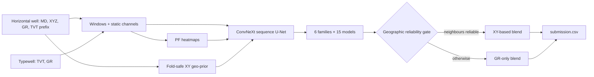

# ROGII Top-Solution Reproduction
### Typewell correlation meets a geographic reliability gate

**An attributed late-submission reproduction of the first- and second-place solutions to ROGII Wellbore Geology Prediction, with checked inference, data insights, and a measured baseline.**

[](https://www.kaggle.com/code/YOUR_KAGGLE_USERNAME/rogii-1st-place-reproduction-insights)
[](#results)
[](#results)
[](THIRD_PARTY_NOTICES.md)
[](https://github.com/YOUR_GITHUB_USERNAME/rogii-wellbore-geology-reproduction/actions/workflows/validate.yml)

[ROGII Wellbore Geology Prediction](https://www.kaggle.com/competitions/rogii-wellbore-geology-prediction) asks for the True Vertical Thickness (TVT) along the unseen toe end of 773 horizontal wells, scored by pooled RMSE in feet. Each well comes with an XYZ trajectory, a gamma-ray (GR) log, a known TVT prefix, and a paired vertical typewell.

This repository packages the competition's top two solutions so they run end to end as a late submission. I audited the data, measured a baseline, and wrapped each upstream ensemble in checked, path-independent inference. The models, weights, and blend design belong to their original authors.

[Open the Kaggle notebook](notebooks/rogii_winner_reproduction.ipynb) · [Read the credits](THIRD_PARTY_NOTICES.md) · [Reproduce the pipeline](docs/reproducibility.md)

## Credits

- **First place: Ruby / w5833946.** Six ConvNeXt sequence U-Net families, 15 models each, blended through a geographic reliability gate. [Write-up](https://www.kaggle.com/competitions/rogii-wellbore-geology-prediction/writeups/1st-place-solution) · [Code](https://github.com/IAmAValidUsername/kaggle_ROGII_1st_place_solution_Ruby) · [Submission notebook](https://www.kaggle.com/code/w5833946/submit-reproduce).
- **Second place: bilzard (tatamikenn).** AnchorCNN, two column-width families of 15 checkpoints each, with 8 MD phase shifts and dynamic-programming decoding. [Weights](https://www.kaggle.com/datasets/tatamikenn/rogii-2nd-place-weights) · [Inference notebook](https://www.kaggle.com/code/tatamikenn/rogii-2nd-place-inference).

Both are Apache-2.0. Licenses, reviewed commits, and every change made here are listed in [THIRD_PARTY_NOTICES.md](THIRD_PARTY_NOTICES.md).

## The two findings

### 1. TVT is a structural depth

Within every training well, the following quantity is constant to within **0.07 ft** (766 of 773 wells have `ANCC`; the other 7 have none):

```text
TVT + Z − ANCC ≈ constant
```

`ANCC` is a training-only formation top. Predicting TVT along the lateral therefore means locating the formation surface relative to the bit, not fitting a free-form curve. The second-place model, for example, decodes a stratigraphic level with dynamic programming instead of regressing TVT row by row.

### 2. The naive answer is far off

Holding the last known `TVT_input` flat over the prediction interval gives **15.91 ft** RMSE across all 773 training suffixes. A geometry prior that extends the recent `TVT + Z` trend did not help reliably on held-out wells (table below). The first-place families reach **4.80–5.54 ft** archived OOF RMSE, so almost all of the gain comes from correlating the lateral's GR log against the typewell.

The audit also found that the three public test wells' public features match three training wells exactly. This overlap is recorded as a diagnostic only: no training label is ever copied to a test prediction, and the hidden leaderboard test set is different.

## Architecture

The Kaggle notebook reproduces the first-place inference and blend:



- **Isolation:** each family runs in its own checked subprocess so similarly named modules cannot leak between families.
- **Gate:** five well-level neighbour diagnostics must all pass the author's thresholds before the XY blend is used.
- **Precision and weights:** the original float32 inference fix, thresholds, and blend weights are preserved; nothing is tuned on test data.
- **Output checks:** submission IDs are rebuilt from the mounted test files, so the hidden rerun cannot be truncated to the public sample.

## Results

| Model | Evaluation | RMSE (ft) |
| :--- | :--- | ---: |
| Last known TVT (this repo) | All 773 training suffixes | 15.91 |
| Last known TVT (this repo) | 100 held-out wells | 15.33 |
| Last known TVT + 0.25 geometry prior (this repo) | 100 held-out wells | 16.47 |
| 1st place, single families (upstream) | Archived OOF | 4.80–5.54 |
| **2nd place AnchorCNN (upstream)** | **Private leaderboard** | **5.802** |

The archived OOF figures and the 5.802 private score are published upstream results. The notebook also prints the first-place conditional blend's RMSE on the author's archived OOF predictions. This repository's own late-submission score will be added only after Kaggle evaluates the run.

## Run it

### On Kaggle

Open [the Kaggle notebook](https://www.kaggle.com/code/YOUR_KAGGLE_USERNAME/rogii-1st-place-reproduction-insights). Attach the competition data and the six `w5833946/rogii-*` datasets, enable a GPU, turn Internet off, then Save & Run All and submit `submission.csv`.

To publish from this repository with the [Kaggle CLI](https://github.com/Kaggle/kaggle-api):

```bash
python scripts/build_winner_notebook.py --username YOUR_KAGGLE_USERNAME
kaggle kernels push -p kaggle
```

### Locally (second place)

Use Python 3.12. CUDA, Apple MPS, and CPU are supported.

```bash
git clone https://github.com/YOUR_GITHUB_USERNAME/rogii-wellbore-geology-reproduction.git
cd rogii-wellbore-geology-reproduction
python -m venv .venv
# Activate the environment, then:
python -m pip install -r requirements.txt
kaggle competitions download -c rogii-wellbore-geology-prediction -p data
kaggle datasets download -d tatamikenn/rogii-2nd-place-weights -p models/second_place --unzip
# Extract the competition archive into data/.
python scripts/predict_second_place.py --data-dir data
```

Downloads require the Kaggle CLI, authentication, and accepted competition rules. The weights are checked against `third_party/anchorcnn/SHA256SUMS` before any code is imported. Use `--checkpoint-limit 1 --phase-limit 1` for a quick smoke run. To rerun the data audit and baselines, run `python scripts/audit_data.py --data-dir data --output outputs/data_audit.json`.

See [all run controls and outputs](docs/reproducibility.md).

## Repository

| Path | Purpose |
| :--- | :--- |
| `notebooks/rogii_winner_reproduction.ipynb` | Kaggle notebook: insights + first-place inference and blend |
| `scripts/build_winner_notebook.py` | Generates the notebook and `kaggle/kernel-metadata.json` |
| `src/rogii/second_place.py` | Checked local inference for the second-place ensemble |
| `src/rogii/baseline.py` | Training-free last-value / geometry baseline |
| `scripts/audit_data.py` | Data audit and held-out baseline evaluation |
| `outputs/data_audit.json` | Committed audit results |
| `scripts/validate.py` | CI checks |
| `docs/reproducibility.md` | Configuration, validation scope, and provenance |
| `THIRD_PARTY_NOTICES.md` | Upstream authors, licenses, and changes |

## Author and citation


Code is released under the [Apache License 2.0](LICENSE). Competition data, model weights, and linked third-party work keep their own terms.
